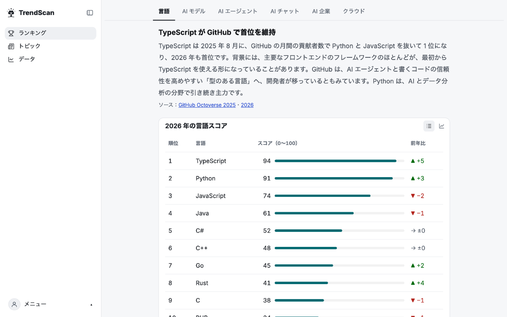
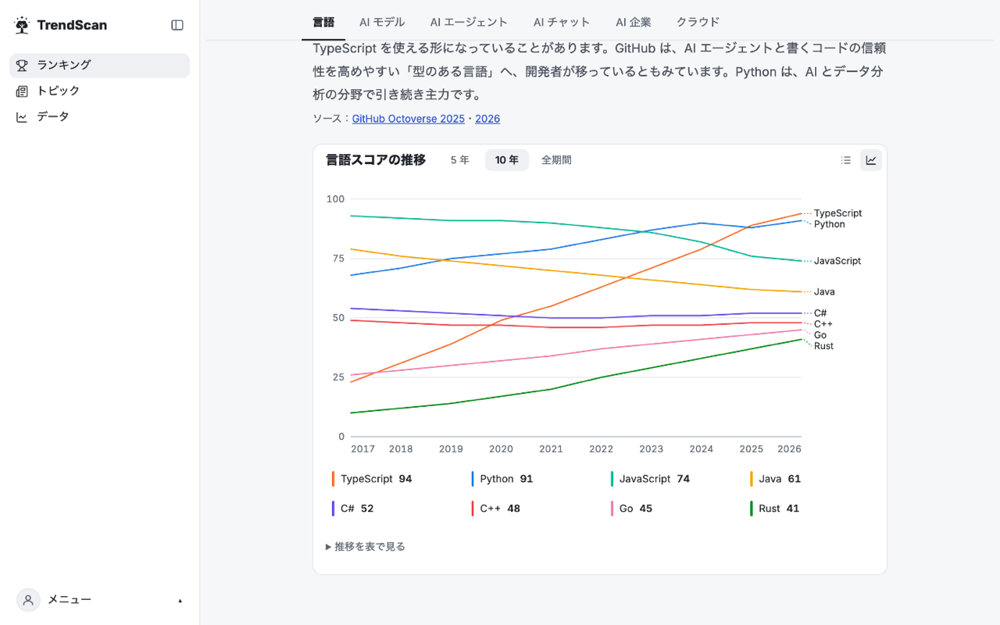
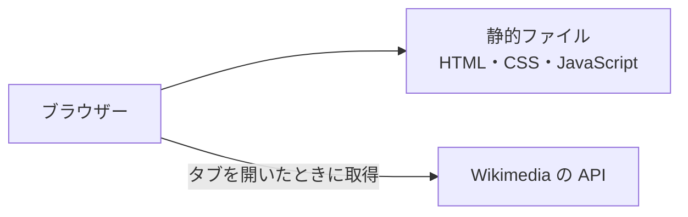

# TrendScan

[English](README.md) | 日本語

IT エンジニア向けの技術トレンドを集めてまとめる、1 ページのサイトです（HTML、CSS、JavaScript。ビルドと API キーは不要）。

**「ランキング」の点数と推移はモック（仮の値）で、測定値でも公式の順位でもありません。** 「データ」の数字と解説もサンプル（モック）の扱いで、AI が公開資料を調べてまとめたものです。詳しくは [docs/data.md](docs/data.md)。

| 言語のランキング | スコアの推移 |
|---|---|
| <a href="docs/images/ranking.png"><picture><source media="(prefers-color-scheme: dark)" srcset="docs/images/ranking-dark.png"></picture></a> | <a href="docs/images/trend.png"><picture><source media="(prefers-color-scheme: dark)" srcset="docs/images/trend-dark.png"></picture></a> |

## 特徴

- **ランキング。** 言語・AI モデル・AI エージェント・AI チャット・AI 企業・クラウドを、短い解説・ソースのリンク・表で示します。アイコンのボタンで推移のグラフに切り替えます（AI モデルを除く）。
- **トピック。** ニュース、キーワード（日本語版 Wikipedia の閲覧数）、Qiita の記事、公式チャンネルから選んだ YouTube 動画へのリンク。
- **データ。** 企業と個人の AI の使い道、IoT・AI の導入率（国内の業種別）と生成 AI の利用率（世界の国別）、IT 企業の売上高の伸び。公表された値を固定しています。
- **実データの要約。** キーワードは、取得した閲覧数から JavaScript が見出しと要点を作ります（理由は推測しません）。ほかの解説と一覧は固定です。
- **ライトとダーク**に対応し、狭い画面向けのレイアウトがあります。

## アーキテクチャ



独自のサーバーはありません。スクリプトは `data.js`（モック・固定の数字と文章）、`frame.js`（サイドパネル・メニュー・テーマ）、`script.js`（タブ・取得・グラフ）の順に読み込みます。

## クイックスタート

```bash
python3 -m http.server 8000 --bind 127.0.0.1
```

<http://localhost:8000/> を開きます。

## ドキュメント

文書は日本語です。

| 文書 | 内容 |
|---|---|
| [docs/data.md](docs/data.md) | モックの範囲・データの出どころと計算方法・利用条件・ライセンス |
| [design-note.md](design-note.md) | サイトの目的と改善したところ |

## ライセンス

[MIT](LICENSE)（コードだけに対するものです。データ・書体・アイコンは、それぞれの規約に従います）
