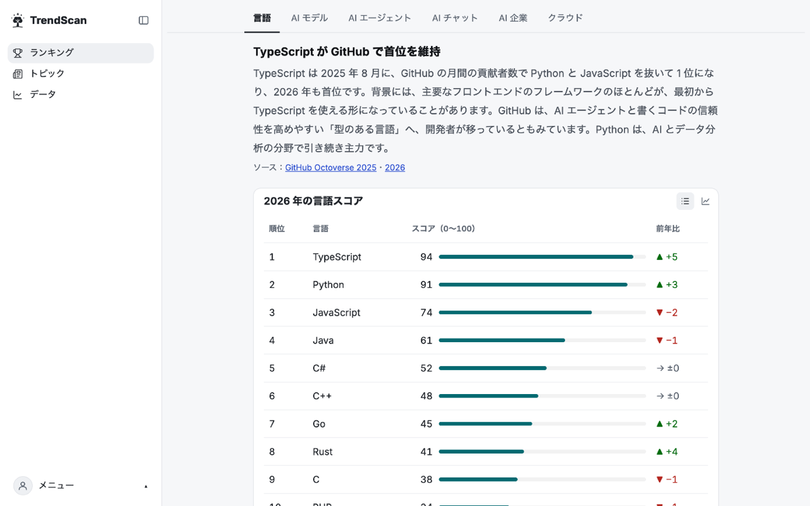
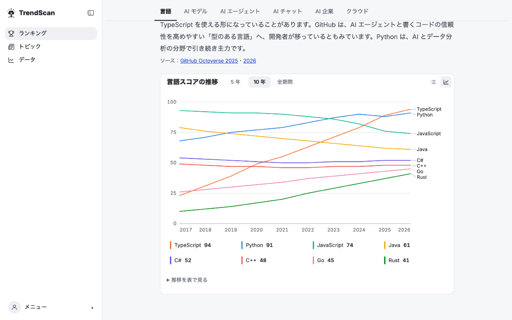
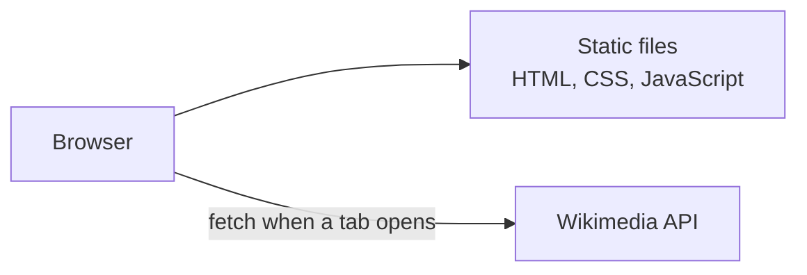

# TrendScan

English | [日本語](README.ja.md)

A one-page site that collects and summarizes tech trends for IT engineers (HTML, CSS, JavaScript; no build step, no API keys). The UI is in Japanese.

**Ranking scores and trend lines are mock values, not measurements or official rankings.** The figures and commentary under Data are also treated as sample (mock) content, summarized by AI from public sources. Details: [docs/data.md](docs/data.md).

| Language ranking | Score trends |
|---|---|
| <a href="docs/images/ranking.png"><picture><source media="(prefers-color-scheme: dark)" srcset="docs/images/ranking-dark.png"></picture></a> | <a href="docs/images/trend.png"><picture><source media="(prefers-color-scheme: dark)" srcset="docs/images/trend-dark.png"></picture></a> |

## Features

- **Rankings.** Languages, AI models, AI agents, AI chat services, AI companies and cloud, each with a short commentary, source links and a table. An icon button switches to the trend chart (except for AI models).
- **Topics.** News, keywords (Japanese Wikipedia page views), Qiita articles and links to selected videos from official YouTube channels.
- **Data.** How companies and individuals use AI, IoT/AI adoption by industry in Japan, generative AI use by country, and revenue growth of IT companies. The figures are fixed values from published sources.
- **Summaries of live data.** For keywords, JavaScript writes the headline and summary from the fetched page views, without guessing reasons. Other commentary and lists are fixed.
- **Light and dark themes**, with a layout for narrow screens.

## Architecture



There is no server of its own. Scripts load in this order: `data.js` (mock values, fixed figures and text), `frame.js` (side panel, menu, theme), `script.js` (tabs, fetching, charts).

## Quick start

```bash
python3 -m http.server 8000 --bind 127.0.0.1
```

Open <http://localhost:8000/>.

## Documentation

The documents are written in Japanese.

| Document | Contents |
|---|---|
| [docs/data.md](docs/data.md) | Mock values, data sources and calculations, terms of use and licenses |
| [design-note.md](design-note.md) | What the site is for and what was improved |

## License

[MIT](LICENSE) (the code only; data, fonts and icons keep their own terms)
